# FEM and Mesh Gallery

Finite elements (`cvc::fem`, [fem.h](../inc/cvc/geometry/fem.h)) and surface geometry processing
(`cvc::mesh_ops`, [mesh_ops.h](../inc/cvc/geometry/mesh_ops.h)) on real datasets, solved on the
tetrahedral meshes LBIE builds and rendered offscreen by cvcGL. Every picture is one run of
[`examples/cvcgl/fem_gallery.cpp`](../examples/cvcgl/fem_gallery.cpp);
[`examples/cvcgl/fem_gallery_docs.sh`](../examples/cvcgl/fem_gallery_docs.sh) holds the exact
command for each picture and regenerates the set. The API reference is
[GEOMETRY_API.md — Mesh Operations and Finite Elements](GEOMETRY_API.md#mesh-operations-and-finite-elements-libigl),
and the plan behind it is [LIBIGL-GEOMETRY-FE-ROADMAP.md](roadmap/LIBIGL-GEOMETRY-FE-ROADMAP.md).

The datasets:

- **Bunny:** the built-in `stanford.bunny`.
- **Head:** TexMol's `LBIE_lib/head.off`, rewritten one vertex per line.
- **CT:** VolRover's `SimpleExample/vh4.rawiv`, a Visible Human torso.

```bash
fem_gallery --mesh stanford.bunny --up y --dim 128 --problem heat --steps 40 --slice y --png heat.png
```

`fem_gallery` builds with `CVC_BUILD_EXAMPLES=ON` and `CVC_ENABLE_LIBIGL=ON`. `--help` lists its
options.

## How a picture is made

1. **Get a solid.** A surface mesh's interior comes from a signed distance field (`cvc::sdf`,
   `SDF_IGL`) at `--dim`³. A CT volume's interior is everything denser than `--iso`.
2. **Mesh it.** `cvc::tetrahedralize` (LBIE) turns the solid into tetrahedra.
3. **Solve.** `cvc::fem` solves the problem with linear elements.
4. **Show the result.** The solid's outer surface is drawn translucent, and a plane cuts through
   the solid to show the interior field. For a surface mesh, the solution is sampled onto the
   input surface, which is smoother than the mesh's own grid-aligned boundary.

## Finite elements on LBIE tetrahedra

**Poisson and heat on the bunny** (59,460 tetrahedra):

- **Poisson:** −Δu = 1 inside, with u = 0 on the boundary.
- **Heat:** the boundary in the lowest 5% of the height is held at 1. Diffusion then runs by
  backward Euler for 10, 40 and 160 steps.

| Poisson | Heat, 10 steps | Heat, 40 steps | Heat, 160 steps |
|:-:|:-:|:-:|:-:|
| 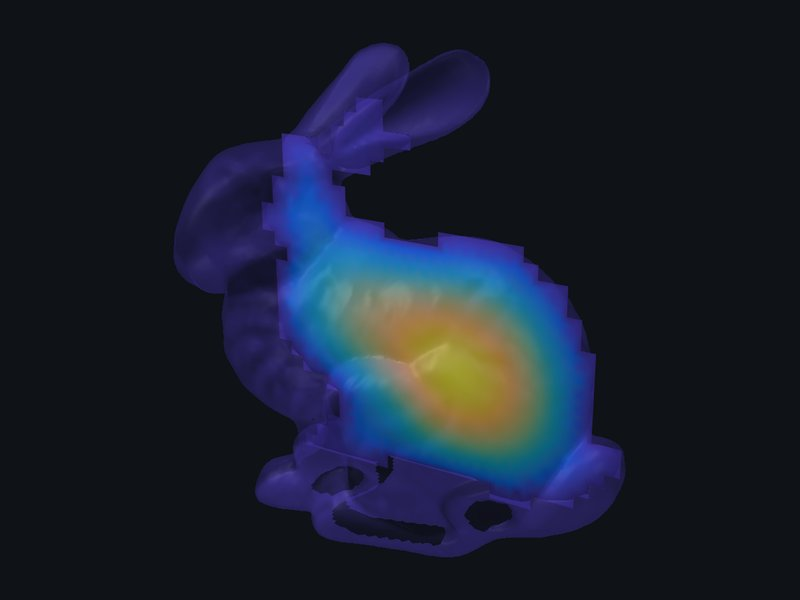 | 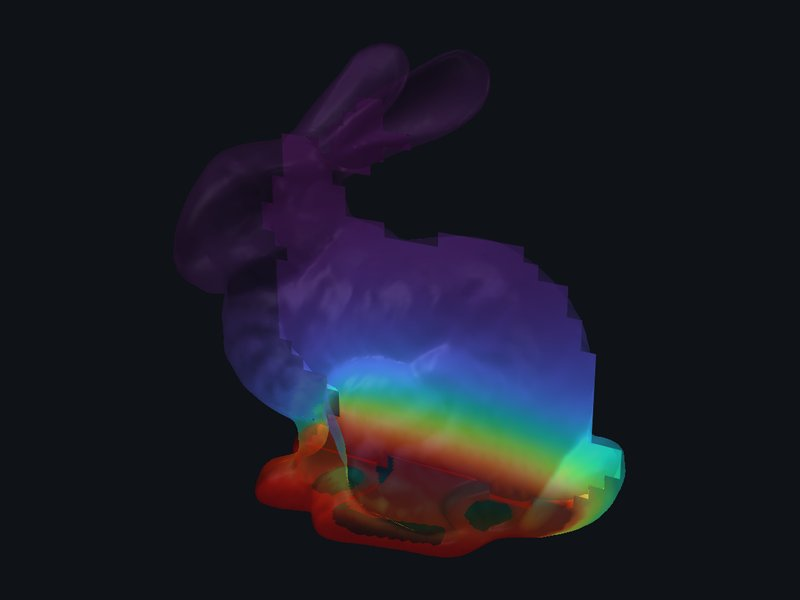 | 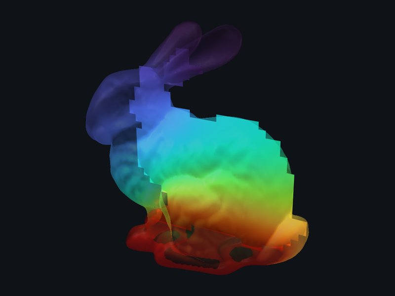 | 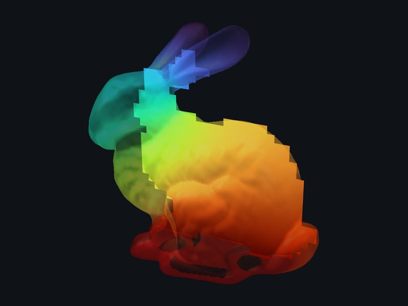 |

**Vibration modes of the solid bunny.** These are the first three non-constant eigenmodes of the
Neumann Laplacian, `fem::laplacian_eigenmodes` on the volume. The first mode is the ears swinging
against the body.

| Mode 1 | Mode 2 | Mode 3 |
|:-:|:-:|:-:|
| 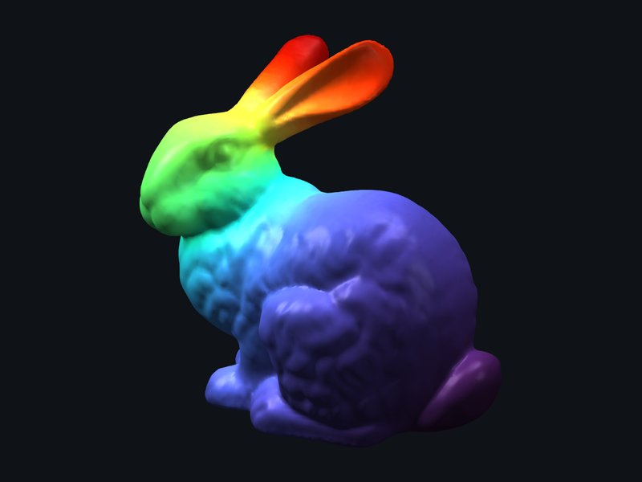 | 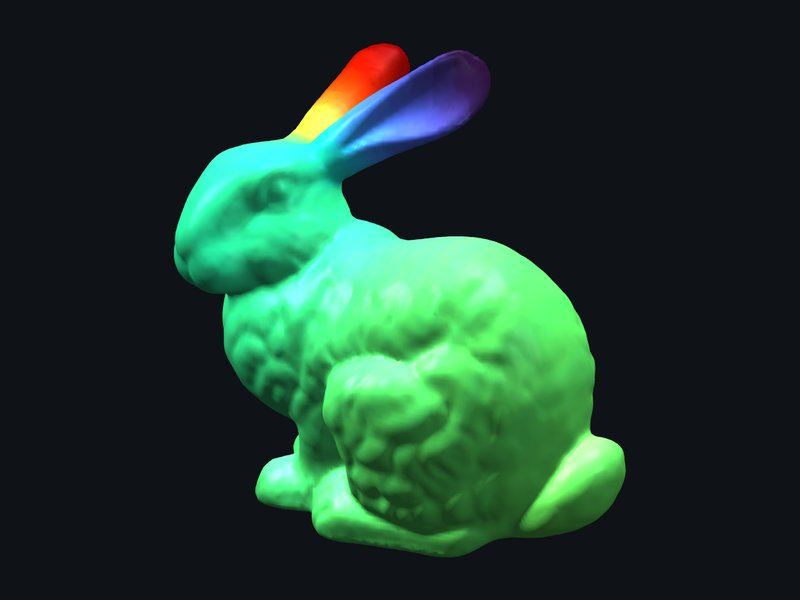 | 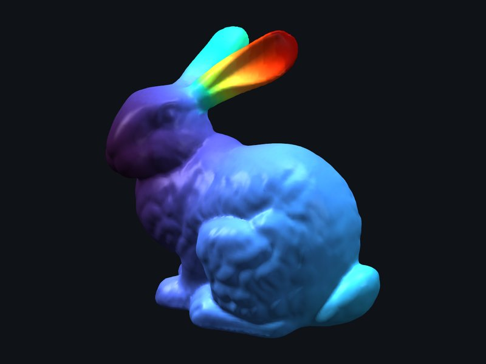 |

**The head** (99,469 tetrahedra) and **the CT torso**:

- **Body:** the CT above density 45 gives 347,680 tetrahedra. The lungs are cavities, so they
  hold u = 0 in the Poisson solve.
- **Bone:** the CT above density 80 gives 127,855 tetrahedra. Heat rises from the floor through
  the spine and ribs. The pieces that the CT does not connect to the floor stay cold.

| Head: Poisson | Head: heat, 60 steps | CT body: Poisson | CT body: heat | CT bone: heat |
|:-:|:-:|:-:|:-:|:-:|
| 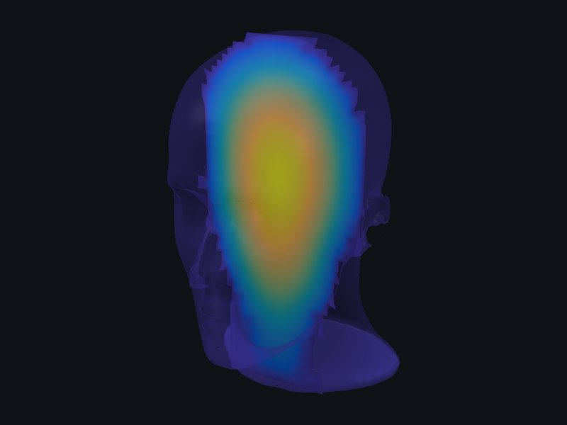 | 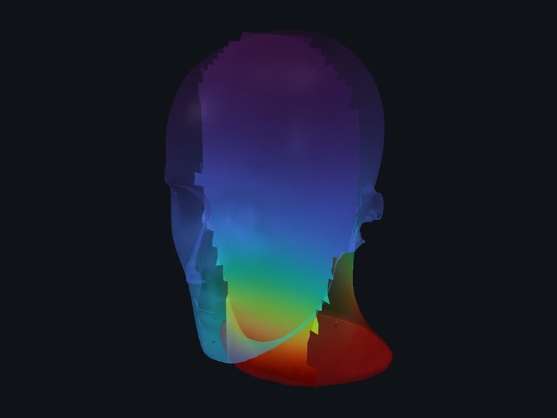 | 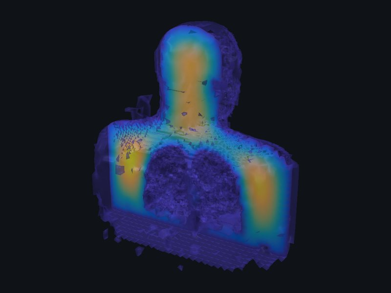 | 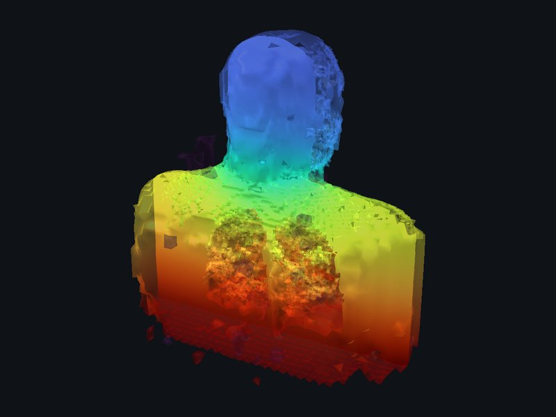 | 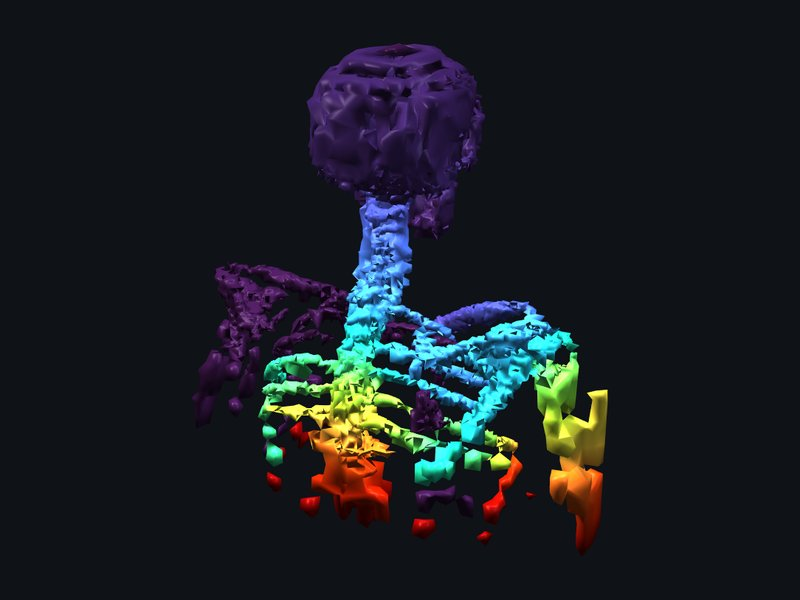 |

## Geometry processing on the surface

These run on the triangle mesh itself:

- **Laplace–Beltrami eigenfunctions:** `fem::laplacian_eigenmodes` on the surface.
- **Mean curvature:** `vertex_curvature`. The head's scan surface is terraced, so it is smoothed
  first with `--smooth 2e-4`. The colours span the 2nd to 98th percentile.
- **Geodesic distance:** `geodesic_distance`, the heat method, measured from the crown.

| Bunny: mode 5 | Bunny: mode 9 | Head: mean curvature | Head: geodesic distance | Head: mode 6 |
|:-:|:-:|:-:|:-:|:-:|
| 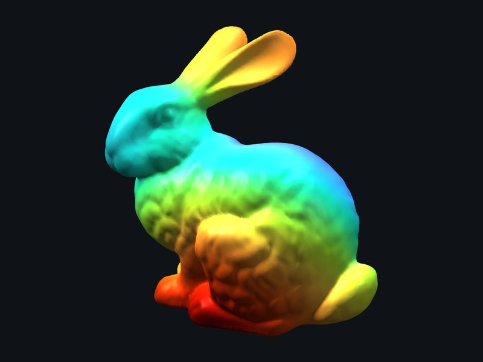 | 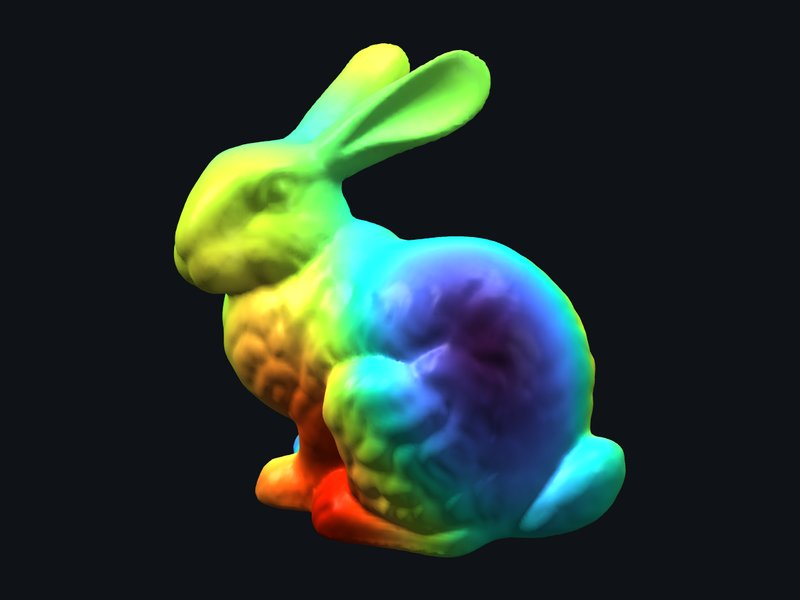 | 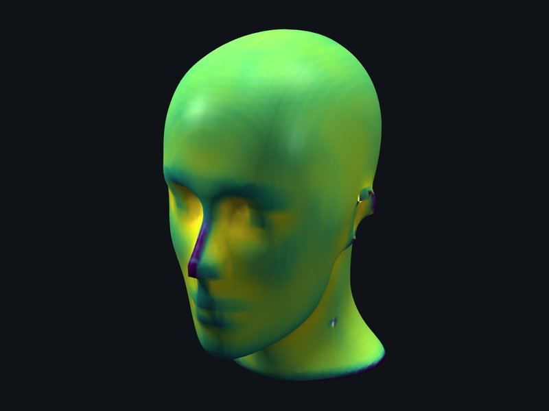 | 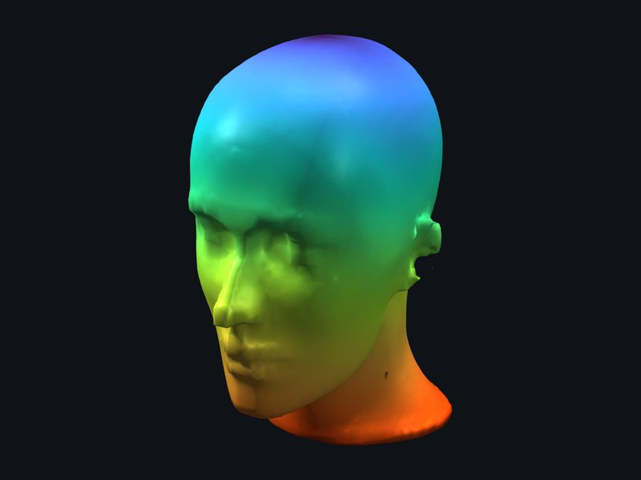 | 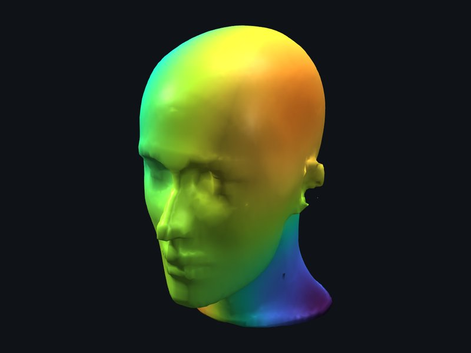 |

## LBIE's meshes

`--problem mesh` draws the mesher's own elements, cut away:

- The elements beyond the plane stay whole, and each element's faces are outlined.
- Each element has one flat colour. `--color-by size` shows the octree level, and
  `--color-by quality` shows the minimum dihedral angle (tetrahedra) or the scaled Jacobian
  (hexahedra; 1 is a cube).

The pictures are the bunny's SDF at 64³:

- **Hexahedra by size:** the adaptive mesh is fine along the surface and coarse inside. The ghost
  is the removed half.
- **Hexahedra by quality:** the mean scaled Jacobian is 0.85. The dark cells, which are poor or
  inverted, sit where the boundary layer meets the coarse interior.
- **Tetrahedra by quality:** the minimum dihedral angle is 26.6° and the mean is 56.8°.

| Hexahedra by size | Hexahedra by scaled Jacobian | Tetrahedra by minimum dihedral angle |
|:-:|:-:|:-:|
| 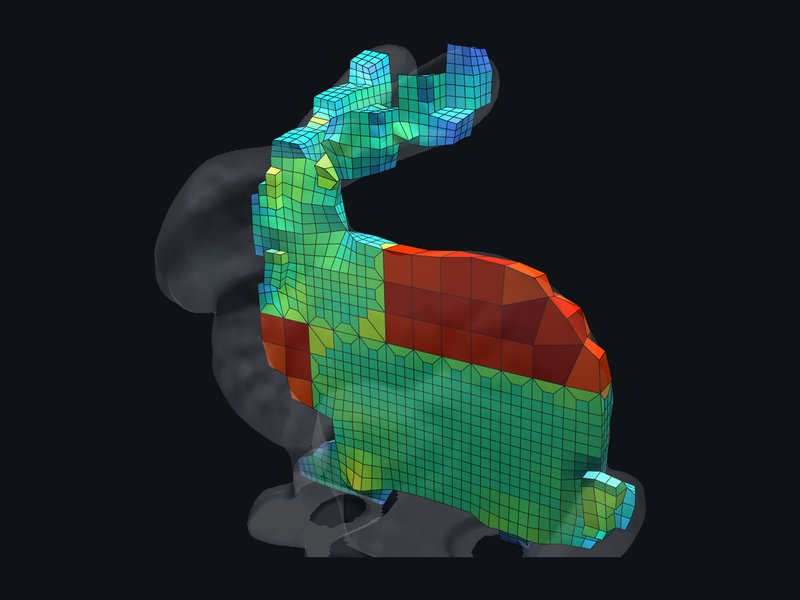 | 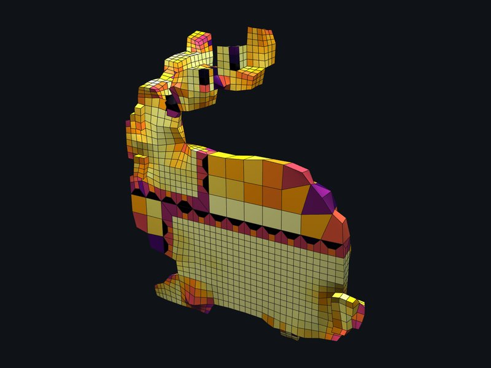 | 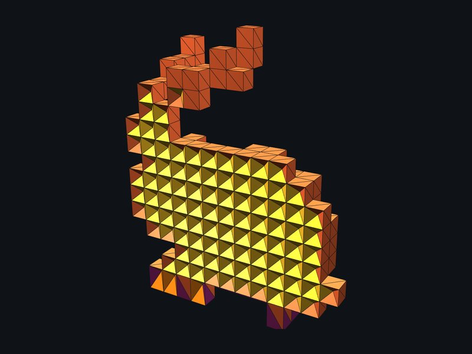 |

`fem_gallery` also exposes LBIE's interval meshing (`--iso2`, through `cvc::tetrahedralize2`) and
its quality-improvement passes (`--improve`). Neither is shown here yet, because of the known
limitations of LBIE through `cvc::` today:

- **Tetrahedra:** the tetrahedral boundary follows the octree grid, a staircase, where the
  hexahedral boundary is fitted to the surface.
- **Geometric flow on tetrahedra:** it lowers the bunny's minimum dihedral angle from 26.6° to
  0.75° and can throw a boundary vertex far out.
- **Interval meshes:** `tetrahedralize2` leaves fans of slivers and holes inside the layer.
- **Hexahedra on the head and the CT:** adaptive hexahedralization collapses about half of the
  hexahedra, which then have repeated corners.
