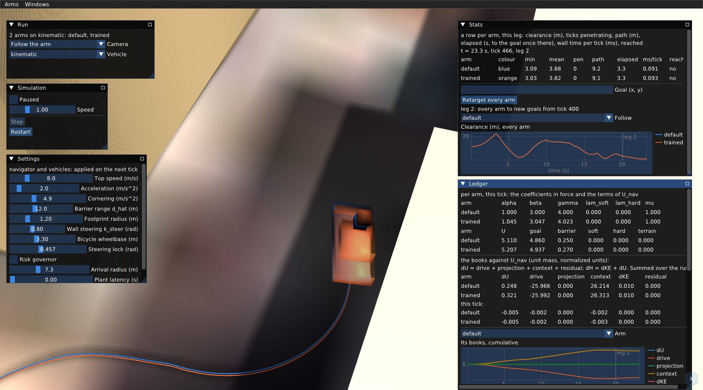
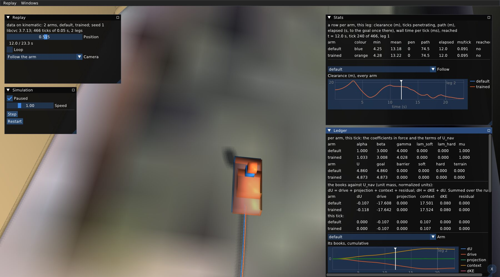
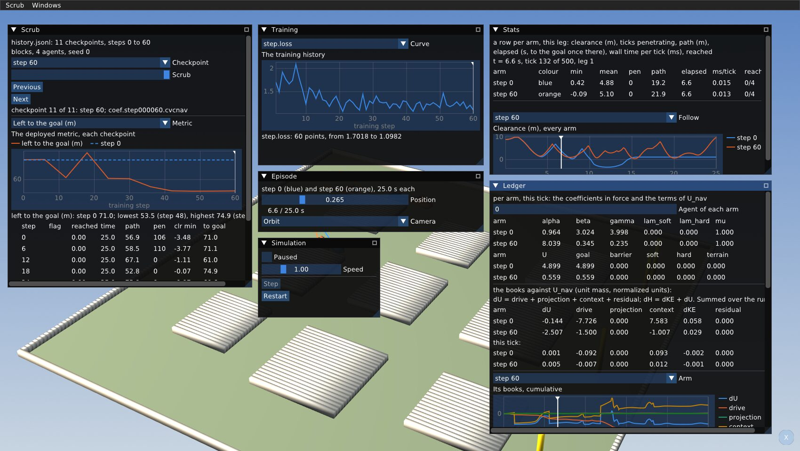
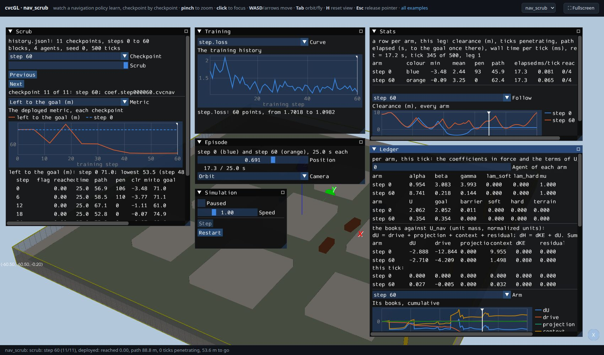

# The nav lab: policies side by side, run logs, replays and the scrubber

cvc::nav compares navigation policies. Several of them run side by side, each in its own world,
on the same world from the same starts to the same goals with the same seed, stepped tick for tick
together: these are the **arms**. What each arm did, tick by tick, is its **run log**. The Stats
and Ledger windows show the run log at a tick, and a **replay** plays it back. The **scrubber**
deploys every checkpoint of a training run the same way, to watch a policy learn.

```bash
python -m pycvc_gl.nav_lab arms --arms default,trained=run/coef.step000200.cvcnav
python -m pycvc_gl.nav_lab arms --arms default,a=A.cvcnav --world flat --cars 3 \
    --headless --frames 600 --log run.cvcrun
python -m pycvc_gl.nav_lab replay run.cvcrun
python -m pycvc_gl.nav_lab scrub run/history.jsonl
```



*`arms` on Austin, kinematic, `default` beside libcvc's trained policy (`--set nav.vehicle.vmax=8
--set nav.vehicle.d_hat=12 --retarget-at 20`): both ghosts and their tracks, the second leg's Stats,
the Ledger with its books (the residual 0), the plant ledger n/a on this plant.*

The logic is the library's (`cvc/nav/nav_arms.h`, `run_log.h`, `nav_panels.h`). The Python
module builds the worlds, draws the ghosts and wires the events. A C++ Ariadne host or a browser
page shows the same cells through the same functions.

Contents:
- [Arms](#arms)
- [The Stats row](#the-stats-row)
- [The Ledger: the books against U_nav](#the-ledger-the-books-against-u_nav)
- [The plant ledger](#the-plant-ledger)
- [The run log](#the-run-log)
- [The windows](#the-windows)
- [Replay](#replay)
- [The scrubber](#the-scrubber)
- [From C++](#from-c)
- [From Python](#from-python)

## Arms

`cvc::nav::arms_run` takes one world per arm. The host builds the worlds and gives each one its
policy (`sim_world::set_policy`, usually through a `policy_library`). The worlds must have the same
agents, tick, frame and centre, and must stand at their starts. The run then:

- turns on each world's drive telemetry;
- arms each world's nav_stats;
- takes the agents' poses and goals as the start and as leg 0.

`step()` steps every world one tick. Each arm goes first in turn, so no arm's wall time always
pays for going first. A host that steps its worlds itself calls `record(a, ms)` after each one and
`end_tick()` once all are done.

`retarget(goals)` (or `retarget(i, x, y)` for one agent) moves every arm's goals on the same tick.
The leg ends, and each arm's nav_stats is armed again at the new goals, so the Stats rows that
follow are the new leg's.

An arm runs exactly as its policy would alone. Its world is its own, and stepping it inside the
run is the same `sim_world::step` (gtest `NavArms.AnArmRunsBitForBitAsItsPolicyAlone`).

In `pycvc_gl.nav_lab arms`:
- An arm is `default` (libcvc's built-in policy, with constant coefficients alpha 1, beta 3,
  gamma 4) or `NAME=PATH.cvcnav`.
- `--cars N` puts N agents in every arm.
- `--plant` names the plant (`kinematic`, `humvee`, `roboracer`, `dynamic:humvee`, ...).
- `--retarget-at T` retargets at T seconds.

Measured on open ground, the arms tie except near walls and near the goal, because every arm
saturates its acceleration toward the goal.

## The Stats row

Each arm gets one row, over its agents and the current leg (`stats.<column>` in the run log):

| column | what |
|---|---|
| `clear_min_m` | the least clearance (m): nav_stats' measured one, else the least the drive telemetry reported |
| `clear_mean_m` | the mean of the drive telemetry's per-tick clearance (m) |
| `pen_steps` | the ticks an agent's centre was in an occupied cell, summed over the agents |
| `path_m` | the path driven (m), the agents' mean |
| `elapsed_s` | the time to the last arrival once every agent is there, else the leg's ticks |
| `ms_step` | the arm's step's mean wall time (ms) |
| `reached` | the agents that reached their goals (with one agent: yes or no) |

With one agent per arm, these are that vehicle's numbers.

## The Ledger: the books against U_nav

The Ledger shows, per arm, the coefficients in force (alpha, beta, gamma, lam_soft, lam_hard, mu)
and the terms of U_nav (the potential, and its goal, barrier, soft, hard and terrain terms), all
from the drive telemetry.

Beside them are the tick's books against U_nav. They follow the vehicle pH white paper's "context
work and projection work", per unit mass, in the drive's normalized units:

| book | what |
|---|---|
| `dU` | U's change over the tick, from where the last tick ended to where this one ends (on the first tick, from where it starts) |
| `drive` | what the drive's motion did to U under the tick's own context: `(potential_end - projection_work) - potential` |
| `projection` | `projection_work`: U's change across what moved the agent after the drive (override_command, min_gap) |
| `context` | `context_work`: what the sense, the field, the coefficients and the goal changed between the ticks (a retarget books here) |
| `dKE` | the change of ½v², v the speed in normalized units per second |
| `residual` | `dU - (drive + projection + context)` |

So `dH = dKE + dU` for `H_nav = ½v² + U_nav`.

The residual is zero, to float round-off, unless something moved the agent between the ticks:
`context_work` is the potential minus last tick's `potential_end`, bit for bit. gtest
`NavArms.TheBooksCloseOnTheKinematicPlant` measures it, and the worst tick is under 1e-5. The
Ledger also shows the books summed over the run and the tick's own books, and charts them.

## The plant ledger

The plant ledger is the energy and the measurements a physics plant feeds nav_stats
(`cvc/nav/plant_ledger.h`). There are 20 items per vehicle, and it is recorded per agent per tick
(`plant.<key>`). An item has a value when its plant fed it and measures what it is reduced from.
Otherwise it is NaN in the log and shows as `n/a`:
- on the kinematic plant, no item applies;
- on the Jolt Humvee, all 20 do.

pycvc binds the item list, so no reader copies it:
- `pycvc.nav_plant_ledger_vehicle()` and `nav_plant_ledger_episode()` give each item's key, unit,
  comment, kind (`measure`, `count` or `flag`), source and the measurements it needs;
- `nav_sim_world_plant_ledger(sim, i)` gives agent i's items now, each with `applies` and its
  value.

## The run log

`cvc.nav.run_log/v1` is JSON lines. An input trace (`docs/INPUT_TRACE.md`) records a run's
**inputs**, so it can be run again and checked. A run log records its **outcomes**, so a viewer
can show them without running anything. Record both to have both: the trace to re-run a session,
the log to look at it.

```
{"schema":"cvc.nav.run_log/v1","libcvc":"3.7.15","dt":0.05,"scale":0.05,"center":[0,0],
 "seed":0,"scene":"flat","plant":"kinematic","agents":1,
 "arms":[{"name":"default","slot":0,"key":"","policy":{"uri":"","sha256":""},"meta":{}},...],
 "start":[[x,y,heading],...],"world":{...},"settings":{...},"meta":{...},
 "columns":{"agent":["x","y",...],"arm":["ms","stats.clear_min_m",...]}}
{"leg":{"index":0,"tick":0,"goals":[[x,y],...]}}
{"tick":1,"t":0.05,"agent":[[[...values...],...],...],"arm":[[...],...]}
...
{"leg_end":{"index":0,"tick":240,"nav_stats":[{...},...]}}
{"leg":{"index":1,"tick":240,"goals":[[x,y],...]}}
...
{"end":{"ticks":600,"nav_stats":[{...},...]}}
```

- **The header** holds:
  - the version that wrote it, the tick, the frame and its centre, the seed, the scene and the
    plant;
  - each arm: its name, its colour slot, its policy's key in its world, and its file with that
    file's SHA-256;
  - each agent's start;
  - `world`, the host's keys that rebuild the world. pycvc_gl.nav_lab writes `run.*`, and with a
    generated world its `world.*` keys too;
  - `settings`, the settings the run used (`nav.*`, `nav_plant.*`);
  - `meta`, the host's own;
  - the columns.
- **A tick** holds:
  - per arm, per agent, a value per agent column: the pose (`x`, `y`, `heading`, `speed`), the
    goal, `reached`, the drive mode, the size (`length`, `width`, `wheelbase`), every drive
    telemetry field (`tel.<field>`), the books (`book.<name>`) and the plant ledger
    (`plant.<key>`);
  - per arm, a value per arm column: `ms` and the Stats row (`stats.<column>`).
- **A leg** starts at the tick index it names. When it ends, every arm's nav_stats record is kept.
- **The end** keeps every arm's last record.

A number is written in its shortest round-trip form, so the log reads back exactly the doubles it
was written from. That is why a replay's cells are the live run's. A value that does not apply, or
was not measured, is `null` and reads back as NaN. A reader finds a column by name, so a later
writer may add columns. A log whose writer stopped early (no end line, or a last line cut short)
still reads, up to its last whole tick.

`arms_options::log_path` streams the log to a file as the run goes, with each line flushed. In
memory, `arms_run::log()` is the same log, growing tick by tick.

## The windows

Two shipped components hold the windows, `src/cvc/ariadne/components/nav_lab_stats.ari` and
`nav_lab_ledger.ari`:

```yaml
import: [cvc://components/nav_lab_stats.ari, cvc://components/nav_lab_ledger.ari]
requires:
  - {name: chart, optional: true}
windows:
  - include: nav_lab_stats
  - include: nav_lab_ledger
```

`cvc::nav::publish_tables` and `publish_charts` (pycvc: `nav_run_log_publish`) write what the
windows show at a tick. They lay it out as pycvc's `Host.set_table` and `set_plot` do:
- a table at `key` holds the row count, with `key.<i>.<column>` for the cells;
- a chart holds `key.s.<i>.{label, x, y, style}` and `key.m.<j>.{x, label, kind}`.

| key | what |
|---|---|
| `arms.stats` | a row per arm: arm, colour, clear_min, clear_mean, pen, path, elapsed, ms, reached |
| `ledger.coef`, `ledger.terms` | a row per arm: the coefficients, the terms of U |
| `ledger.books`, `ledger.tick` | a row per arm: the books summed to the tick, the tick's |
| `ledger.plant`, `ledger.plant_note` | the chosen arm's plant ledger (key, value, unit), and how many of its items apply |
| `arms.clearance`, `ledger.cum`, `ledger.compare` | the charts: every arm's clearance, the chosen arm's books summed, one book summed for every arm, with a marker where each leg starts |

The document picks:
- `ledger.agent`, an arm's name: the plant ledger and the summed books chart are that arm's;
- `ledger.vehicle`, an agent index: the Ledger's rows are that agent's in each arm;
- `ledger.book`: the book the comparison chart draws.

`arms.names` (one name per line) and `arms.agents` feed the combos. A host writes `arms.time` and
handles two events: `arms.retarget` (with `arms.goal`, "x, y") and `arms.seek`.

The charts need Ariadne's `chart:` widget, which is in libcvc 3.7.14. On an older host they are
hidden, and the tables show the same numbers.

## Replay

`cvc::nav::replay_view` plays a run log. Each frame:
- its play head moves, driven by the document's transport (libcvc's `sim_transport`: `sim.paused`,
  `sim.speed`, with Step and Restart wired by the host). `play.pos` follows the play head and moves
  it when dragged; `play.loop` wraps it at the end;
- the tables show the tick at the play head, through the same functions the live run used;
- the charts are written once, and again when the choice changes. They draw the whole run, with a
  cursor at `play.t`;
- `frame::poses` gives every arm's agents' poses at the play head, between the ticks either side
  of it, for the host to draw.



`pycvc_gl.nav_lab replay` rebuilds the recorded world from the header's world keys, and draws each
arm's ghost and its track up to the play head. `--at`, `--paused` and `--loop` set where and how
it starts. Headless, no world is built.

## The scrubber

The scrubber is for watching a policy learn. It deploys every checkpoint a training history names
on one scenario, headless, and shows checkpoint k beside step 0. [NAV_SCRUB.md](NAV_SCRUB.md)
covers its view (the world, the two runs, every window) and how learning is, and is not,
demonstrated with it.

```bash
cvc nav scrub run/history.jsonl                           # every checkpoint, a table
cvc nav scrub run/history.jsonl --agents 8 --ticks 900 --report scrub.json
cvc nav scrub run/history.jsonl --plant kinematic         # on nav's bicycle
python -m pycvc_gl.nav_lab scrub run/history.jsonl        # the view
```

**The history.** A training history is JSON lines.
- cvc::nav's coef_trainer writes one when `train_config::history_path` is set
  (`cvc.nav.coef_train_history/v1`, [NAV_TRAINING.md](NAV_TRAINING.md)). With `checkpoint_prefix`,
  it also saves each checkpoint's policy as a `.cvcnav`.
- GRL-SNAM's trainers write the same kind of file.

How the scrubber reads one:
- A record's `kind` names its series: `step.loss`, `checkpoint.fitness`,
  `checkpoint.heads.alpha.mean`, and so on. The Training window draws them.
- A checkpoint record names its policy in `blob` (or `checkpoint`). A relative path is resolved
  beside the history first.
- Only a `.cvcnav` is deployed. A `.pt` needs torch, so it is listed as skipped. A blob that is
  not on disk is listed as missing.
- The end record's `selected_step` (or a checkpoint's `"selected": true`) marks the pick.
- A file may hold several runs, each starting at its header. `--run` picks one; the default is the
  last.

**The scenario.** The scenario is a world described by an input trace's header (a complete
`cvc.nav.sim_world/v1` world with its maps embedded), its agents, and the number of ticks.
- **The built-in one** is a walled 120 m square with a 3 x 3 grid of buildings and streets between
  them, each building nudged and sized by `--seed`. `--agents` agents (4 by default) start on its
  west side and drive to goals on its east, at a scale of 0.05 normalized units per metre and
  0.05 s a tick, with the map known. Their start and goal lanes come from `--seed`, 8 m apart
  where they fit, so no two cars start or end on top of each other.
- **`grid_scenario`** (C++, `cvc/nav/nav_scrub.h`) puts one on a world as the navigator sees it,
  a `cvc::nav::world_grid`: a data bundle's city, a generated world or a flat square, at its real
  size in metres. Its agents start 12 m apart on free ground, 4 m clear of anything blocked, each
  to a goal 12 m from every start and every other goal and at least 0.3 of the world's span
  away. `nav_scrub` runs its document's world this way (NAV_SCRUB.md).
- **`--scenario TRACE`** uses a recorded input trace's world and agents. Its inputs are not
  replayed.

**The plant.** `--plant` names what the agents drive.
- **`humvee`**, the default when libcvc has Jolt, puts them on Jolt Humvees. The world's blocked
  cells are added to the physics world as static boxes, 3 m tall (each row's runs of cells merged
  down the rows into rectangles: 13 boxes on the built-in blocks). A Humvee that drives into a
  building stops against it.
- **`kinematic`** is nav's kinematic bicycle, the default without Jolt. It has no collision
  response, so a policy that steers into a building drives through it, and the run counts the
  ticks it spends inside (`pen_steps`).
- Any other name `cvc::physics::plant_host` takes (`roboracer`, `dynamic:humvee`, ...) works too.

nav does not depend on physics, so the plant reaches the scrubber through a hook:
`scrub_scenario::plant` names it, and `scrub_options::plant` attaches it to each deployed world.
`cvc::physics::scrub_plant()` (`cvc/physics/scrub_plant.h`) is the hook the CLI and the Python
view use. On a real world, `scrub_plant(geometry)` gives each plant that world's own colliders
(its terrain and buildings, `cvc::world::world_geometry`) in place of the boxes, and starts each
vehicle on its terrain.

Each checkpoint's blob replaces the world's own policy for every agent, and the run is an arms run
with one arm. So checkpoint 0 deployed here is the untrained policy's arm anywhere else, tick for
tick (gtest `NavScrub.Checkpoint0DeployedIsTheUntrainedArm`). A blob deployed twice gives the same
run (`NavScrub.OneBlobDeployedTwiceIsTheSameRun`).

**The cache.** Each run is a run log, cached at
`<history>.scrub/<blob sha256, 16 hex>-<scenario hash>.cvcrun`. The scenario's hash covers:
- its world, agents and settings;
- the plant;
- the ticks;
- the scrubber's version and libcvc's.

So changing any of them deploys the checkpoints again. `--no-cache` neither reads nor writes the
cache.

**The metrics** come from each run's last tick:

| metric | what |
|---|---|
| `reached` | the share of agents at their goals |
| `time_s` | the elapsed time (the Stats row's) |
| `path_m` | the agents' mean path |
| `pen_steps` | the ticks an agent's centre was in a wall |
| `clear_min_m`, `clear_mean_m` | the least and the mean clearance |
| `goal_m` | the agents' mean distance left to their goals |

`--report R.json` writes them all for every checkpoint (`cvc.nav.scrub/v1`).



*`python -m pycvc_gl.nav_lab scrub` on a 60-step coef_trainer run on the built-in blocks' own map,
captured on the kinematic bicycle before the Humvee was the default: the ticks penetrating fall
from 106 to 0 and the distance left to the goals from 71 m to 54 m, checkpoint 60 (orange) beside
step 0 (blue).*

**The view.** `cvc::nav::scrub_view` writes every window, so the Python view and the C++ one are
the same. Libcvc's `nav_lab_scrub` component holds its three windows:

- **`nav_lab_scrub`** holds the controls:
  - the plant, when the checkpoints were deployed on more than one (a combo, `scrub.plant_choice`
    over `scrub.plant_labels`). It shows the same checkpoint on the other plant, at the same play
    head;
  - the checkpoint, picked by a combo (`scrub.choice`), a slider (`scrub.pos`), Previous and Next
    (`scrub.prev`, `scrub.next`), or a click on a chart (`scrub.pick`, then `scrub.pick_step`);
  - the deployed metric against the step, with step 0's as a dashed line (`scrub.metric`;
    `scrub.metric_name` picks the metric);
  - the table (`scrub.table`), one row per checkpoint, with k marked.
- **`nav_lab_training`** draws a series from the history (`scrub.curve`, picked by
  `scrub.curve_name`), with the pick marked.
- **`nav_lab_episode`** shows the episode's position and time. libcvc's `sim_transport` steps it.

Both charts carry a cursor at checkpoint k's step. Checkpoint k's log and step 0's are stacked
side by side as two arms, step 0 blue and k orange. The Stats and Ledger windows show them at the
play head, and the play head keeps its time when another checkpoint is picked.

**In a browser.** `examples/ariadne/nav_scrub` is a C++ Ariadne host for the scrubber, and
libcvc's demo gallery (https://transfix.github.io/libcvc/nav_scrub/) runs it in the page. Its
world is the document's: south Austin from its bundle by default, at its real size, or a
generated world, a flat square or the built-in blocks (`--world`). Each run's vehicles are the
Humvee model. With no `--history`, it first trains cvc::nav's own coef_trainer for 60 steps on
the world's own map, in that map's frame, saving a checkpoint every 6 steps. It then deploys the
11 checkpoints on each `--plant` (by default the Humvee, then the kinematic bicycle to compare;
the Plant combo switches) and shows `examples/ariadne/nav_scrub/nav_scrub.ari`: the same
windows, written by the same `scrub_view`. The training, the deploys and the view all run in the
page (single-threaded wasm, same-origin, nothing fetched); natively the whole sequence takes
about 10 s on Austin. The document, the component library and the Austin bundle are preloaded
into the page's file system. [NAV_SCRUB.md](NAV_SCRUB.md) has its world, its vehicles and every
window.



*The gallery page in headless Chrome (software WebGL), after it trained and deployed in the page,
captured on the blocks and the kinematic bicycle before the page ran on Austin's world: the same
numbers as the native run (step 60: path 88.8 m, 0 ticks penetrating, 53.6 m to go).*

```bash
nav_scrub examples/ariadne/nav_scrub/nav_scrub.ari --component-path src/cvc/ariadne --bundle <austin_south>
nav_scrub examples/ariadne/nav_scrub/nav_scrub.ari --world generated     # no Austin here
nav_scrub examples/ariadne/nav_scrub/nav_scrub.ari --history run/history.jsonl --agents 8
nav_scrub examples/ariadne/nav_scrub/nav_scrub.ari --plant humvee   # the Humvee alone
```

## From C++

```cpp
#include <cvc/nav/nav_arms.h>
#include <cvc/nav/nav_panels.h>

std::vector<std::unique_ptr<cvc::nav::sim_world>> worlds;   // one per arm, policies set
...
cvc::nav::arms_options o;
o.scene = "blocks";
o.log_path = "run.cvcrun";
cvc::nav::arms_run run(std::move(worlds), {{"default"}, {"trained", "coef.cvcnav"}}, o);
for (int k = 0; k < 600; ++k)
  run.step();
run.finish();

// the windows at the last tick, into an app's tree under the document's prefix
const cvc::nav::run_log &log = run.log();
cvc::nav::panel_choice c = cvc::nav::read_choice(app, prefix, log);
cvc::nav::publish_tables(app, prefix, log, log.ticks() - 1, c);
cvc::nav::publish_charts(app, prefix, log, c);

// a replay
auto rec = std::make_shared<const cvc::nav::run_log>(cvc::nav::run_log::read("run.cvcrun"));
cvc::nav::replay_view view(rec);
// each frame: view.update(app, prefix, dt); draw frame.poses
```

## From Python

```python
import json, pycvc

run = pycvc.nav_arms_create([w0, w1], ["default", {"name": "trained", "uri": path}],
                            scene="blocks", log_path="run.cvcrun")
for _ in range(600):
    pycvc.nav_arms_step(run)
pycvc.nav_arms_finish(run)
log = pycvc.nav_arms_log(run)
a = pycvc.nav_run_log_arrays(log)        # "x": (T, A, N), "stats.path_m": (T, A), "t": (T,)
rows = pycvc.nav_run_log_tables(log)     # the windows' tables at the last tick
head = json.loads(pycvc.nav_run_log_header(log))
```

`nav_run_log_read`, `nav_run_log_write`, `nav_run_log_legs`, `nav_run_log_end`,
`nav_run_log_charts`, `nav_run_log_poses`, `nav_run_log_stack` and `nav_replay_view_*` cover the
rest. `bindings/pycvc/test_pycvc_nav_lab.py` exercises them.
