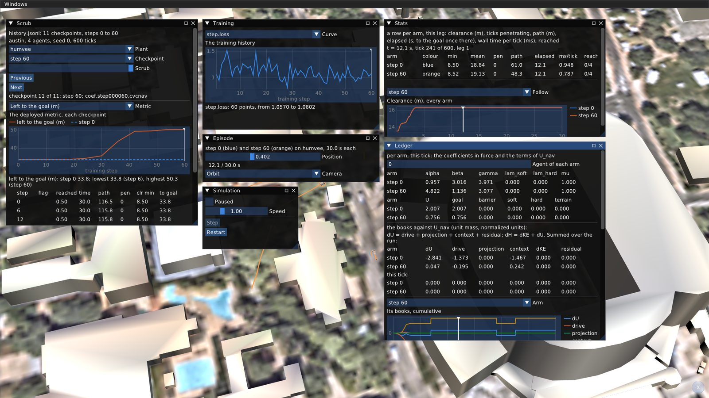
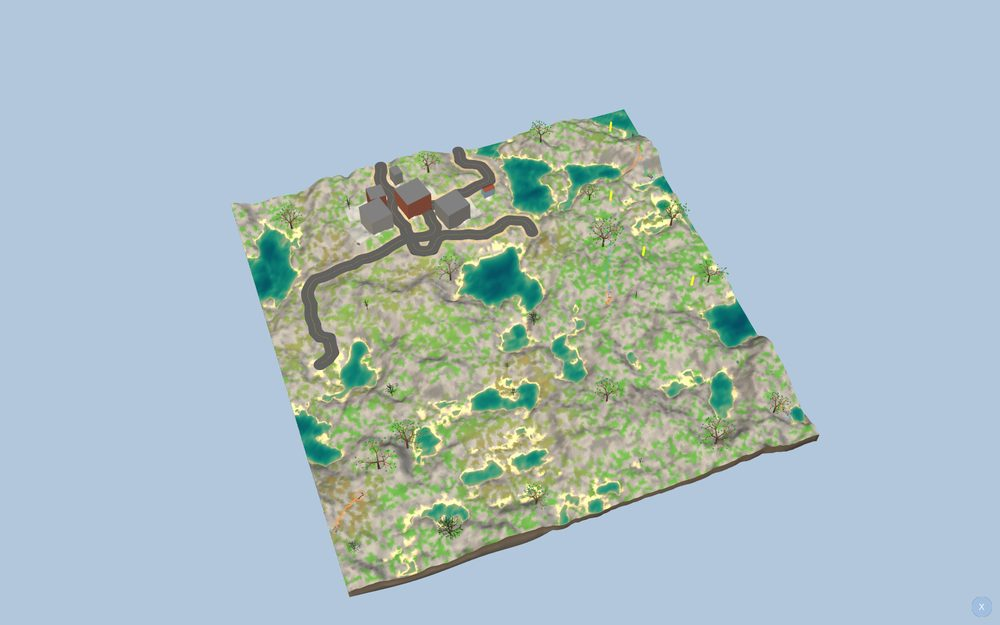
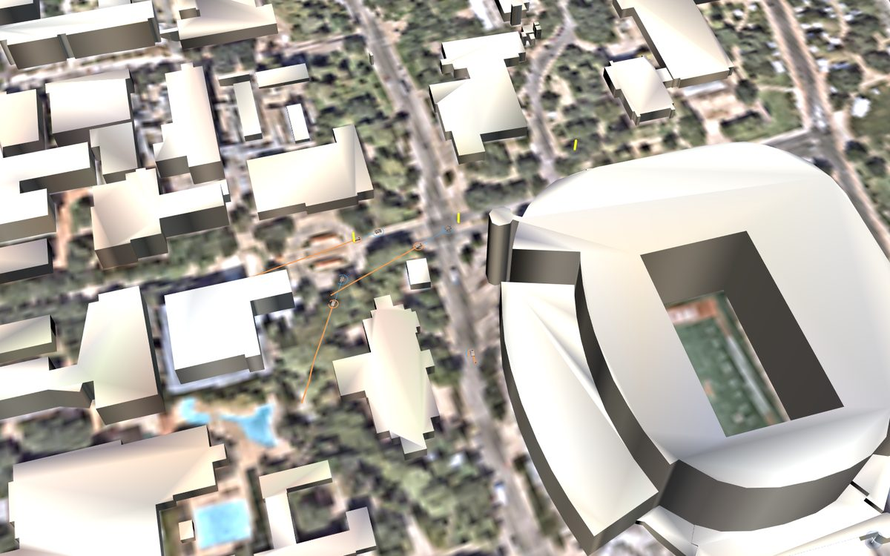
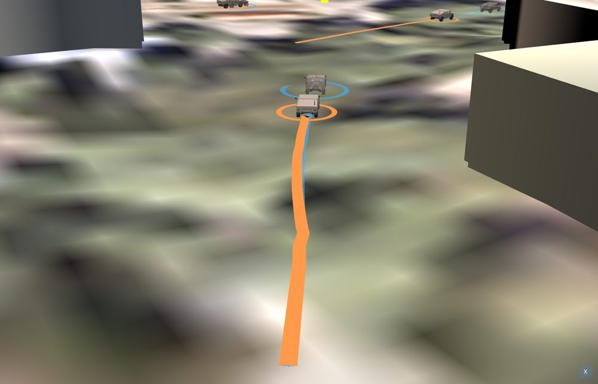
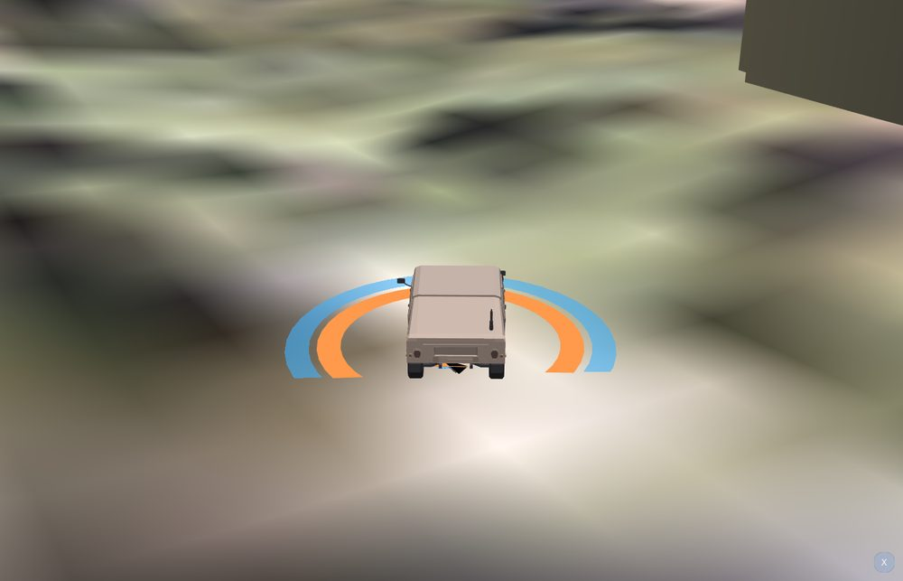
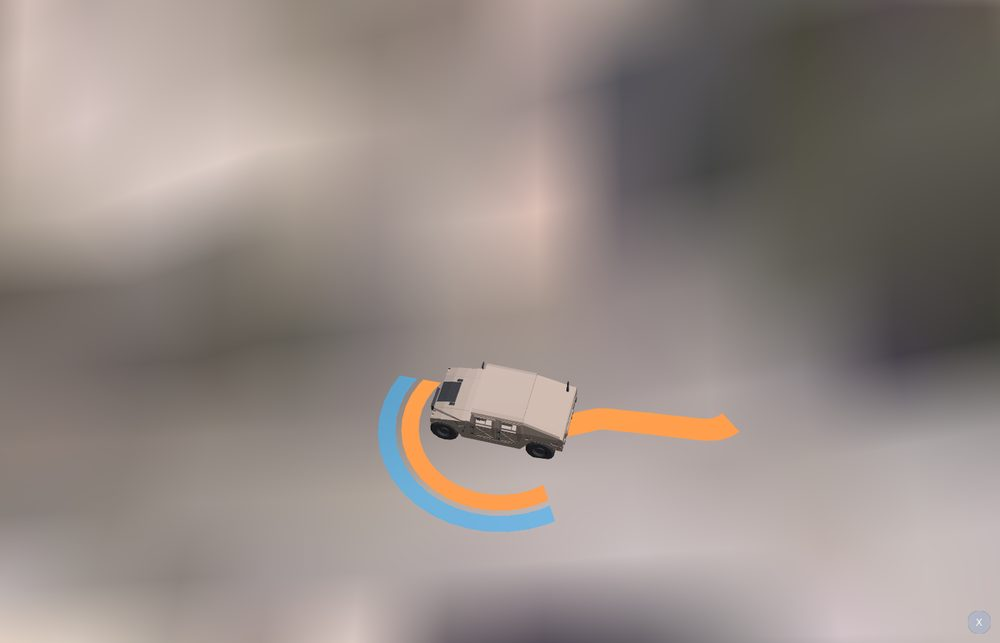

# The scrubber: watching a policy learn

The scrubber deploys every checkpoint of a training run on one scenario and shows checkpoint k
beside step 0. Step 0 is the untrained policy, so the difference between the two runs is what the
first k steps of training changed. This page covers three things:
- the scrubber's view: its world, its vehicles and each of its windows;
- what it compares;
- how a scrub fits into showing that a policy learned, and what the current results are.

The library side (the history, the scenario, the plants, the cache, the metrics, the CLI) is in
[NAV_LAB.md, "The scrubber"](NAV_LAB.md#the-scrubber).

```bash
nav_scrub nav_scrub.ari --component-path src/cvc/ariadne --bundle <prefix>/share/cvc-scenes/austin_south
nav_scrub nav_scrub.ari --net-allow https://cvcpkg.org        # Austin fetched from cvcpkg.org
nav_scrub nav_scrub.ari --world generated                     # a generated world; or flat, or blocks
nav_scrub nav_scrub.ari --history run/history.jsonl           # your own training run
cvc nav scrub run/history.jsonl --report scrub.json           # the same numbers, headless
python -m pycvc_gl.nav_lab scrub run/history.jsonl            # the Python view (the blocks)
```

`nav_scrub` is `examples/ariadne/nav_scrub`, a C++ Ariadne host. It shows
`examples/ariadne/nav_scrub/nav_scrub.ari`, and libcvc's gallery runs it in a browser page.



*South Austin, 4 agents, seed 0, 600 ticks, on the Jolt Humvee. The run is 60 training steps of
cvc::nav's coef_trainer on this map, with a checkpoint every 6 steps; the picture is at the play
head's 12.1 s. On this scenario training made the Humvee runs worse: 33.8 m left to the goals at
step 0, 50.3 m at step 60. See [Where it stands](#where-it-stands) for why one scrub cannot show
learning either way.*

Contents:
- [The world](#the-world)
- [The two runs](#the-two-runs)
- [Why cars overlap, and what was wrong](#why-cars-overlap-and-what-was-wrong)
- [The windows](#the-windows)
- [What is compared](#what-is-compared)
- [How learning is demonstrated](#how-learning-is-demonstrated)
- [Where it stands](#where-it-stands)
- [The host's options](#the-hosts-options)

## The world

The world is the document's, as in every Ariadne port: the scene's world nodes, run by libcvc's
world runtime (`cvc::ariadne::SceneWorld`, `world: <name>` on a node, ARIADNE.md §5.17). It is
never rescaled. Sim units are world units: the world stays in metres, and the agents run at 0.05
normalized units per metre, the frame the nav demos and the trainer use (one unit is 20 m).

`nav_scrub.ari` has three world nodes, and `--world` picks one:

| `--world` | the node | what it is |
|---|---|---|
| `city` (the default) | `city`, `source: { data: city }` | south Austin from the `scene-austin-south-small` bundle: its terrain wearing the aerial image, and its buildings. `region:` cuts a square round its centre for the physics and the navigator (320 m asked; 346 m once cut to the terrain's whole samples); all of it is drawn. |
| `generated` | `land`, `type: generated_world` | a generated world (terrain, lakes, a small town, trees), 320 m across, for a host with no Austin |
| `flat` | `square` | a flat walled square, 240 m across |
| `blocks` | none | the built-in 120 m square of nine buildings, which the host draws itself |



*`--world generated` at 20 s: the fallback for a host with no Austin, its terrain at heights from
3 m to 11 m under the four starts.*

The host keeps only the chosen world's node, binds the `data:` entry (to `--bundle`'s directory
when one is given), and waits for the world runtime to report the world. It then reads two things
from the runtime:
- **the grid** (`SceneWorld::grid`: 2 m cells over the world's terrain, blocked where a building
  or a deep lake is), which the scenario and the training use;
- **the geometry** (`SceneWorld::world_geometry`: the terrain and the buildings in metres), which
  the Jolt Humvee collides with (`cvc::physics::scrub_plant(geometry)`). Each Humvee starts on the
  terrain under it, and a building stops it.

Without a bundle (no `--bundle`, no `CVC_NAV_BUNDLE`, no install under `CVC_PREFIX`,
`CVCPKG_PREFIX` or `CONDA_PREFIX`, no `/bundle` in a browser page) and without `--net-allow`, the
city falls back to the generated world, and says so. A world that does not come up falls back to
the blocks.

**The scenario** is `cvc::nav::grid_scenario` on that grid. Every agent starts on free ground,
4 m clear of anything blocked and at least 12 m from every other start. Each goal is drawn the same
way: 12 m from every start and every other goal, and at least 0.3 of the world's span from its own
start. Every agent starts facing its goal, and all of it follows from `--seed`. On Austin the four
legs are 105 m to 256 m.

## The two runs

Each run's vehicles are the Humvee model (`Humvee.glb`, from the scene bundle or the
`vehicle-humvee` package) at the Humvee's true size, 4.84 m long. Each is posed on the ground under
it at every frame, from the run log's pose at the play head. Where no model is installed, each is a
box with a cabin and wheels, in its run's colour.

| | step 0 (the untrained policy) | checkpoint k |
|---|---|---|
| colour (Stats and Ledger too) | blue, chart slot c0 | orange, chart slot c1 |
| vehicle | translucent (opacity 0.38) | opaque |
| ring on the ground round it | 3.6–4.2 m, outside | 2.8–3.4 m, inside |
| trail behind it, to the play head | 0.6 m wide, translucent | 0.9 m wide, opaque |

Each goal is a yellow post, 10 m tall.



*Overview at 14 s (the default camera). Two agents' runs have parted: blue rings ahead of or
beside orange ones. The other two are still on top of each other.*



*Agent 3 at 9 s. Step 0 (translucent, blue ring) is ahead of checkpoint 60 (opaque, orange
ring). Their trails run together from the start and part a few metres before the vehicles.*

## Why cars overlap, and what was wrong

No pose is moved to keep two vehicles apart: every vehicle is where its run put it.

**Between the runs, by design.** Step 0 and checkpoint k start from the same poses, so both runs'
vehicles sit on top of each other at the start. Where the two policies steer alike they stay
together. The opaque k vehicle then hides the translucent step-0 one, and the two rings show that
two vehicles are there.



*0.3 s in: one Humvee visible, two rings. Both runs are here.*

**Within a run, a scenario bug, now fixed.** The built-in blocks scenario (`default_scenario`)
drew each agent's start lane and goal lane on their own, with no separation, so two cars of the
same run could start, or aim, on top of each other. Nothing was wrong with the plant: the
scenario put them there. Now:
- the built-in scenario keeps its lanes 8 m apart where they fit (gtest
  `NavScrub.NoTwoCarsStartOrEndOnTopOfEachOther`);
- `grid_scenario` keeps starts 12 m apart, and keeps goals 12 m from every start and every other
  goal (`NavScrub.AScenarioOnAWorldGridAtItsRealSize`).

Two cars of one run can still meet mid-run. On nav's kinematic bicycle they pass through each
other, because it has no collision response. On the Humvee, Jolt's chassis collide.

**The Humvee under the terrain, also fixed.** On a world whose terrain is not at height 0 (the
generated world), the geometry plant started every Humvee at `ground_z`, under the terrain. Each
run's path was then 0 m. The hook now starts each one on the terrain (gtest
`ScrubPlant.OnAWorldsGeometryTheHumveeDrivesItsGroundAndMissesItsBuildings`, on terrain raised
5 m).

## The windows

Every window is written by `cvc::nav::scrub_view`, which the Python view uses too. The windows
are libcvc components: `nav_lab_scrub.ari` (Scrub, Training, Episode), `sim_transport.ari`
(Simulation), `nav_lab_stats.ari` (Stats) and `nav_lab_ledger.ari` (Ledger).

**Scrub** picks the checkpoint and shows what each one did.
- Two lines: the history (its file, its checkpoints, their steps), then the scenario (the world,
  the agents, the seed, the ticks).
- **Plant** (`scrub.plant_choice`) is shown when the checkpoints were deployed on more than one
  plant (by default the Humvee, then nav's kinematic bicycle). It shows the same checkpoint on the
  other plant, at the same play head.
- **Checkpoint** (a combo), **Scrub** (a slider over the checkpoints), **Previous** and **Next**
  pick k. So does a click on either chart.
- A line names the pick: "checkpoint 11 of 11: step 60; coef.step000060.cvcnav", with ", the pick"
  when the history marks it as the run's selected checkpoint.
- **Metric** picks what the chart shows: reached the goal, time, path, ticks penetrating,
  clearance min, clearance mean, or left to the goal.
- **The chart**: the metric for each checkpoint against its training step (orange), step 0's as a
  dashed line (blue), and a cursor at k. A line under it gives step 0's value and the lowest and
  highest.
- **The table**: one row per checkpoint, with `>` at k. Its columns are step, flag (`pick` or
  `best`, as the history marks them), reached, time, path, pen, clearance min and to goal: each
  run's last tick (the metrics table in NAV_LAB.md).

**Training** shows the history itself.
- **Curve** picks one of its series: `step.loss`, `checkpoint.fitness`,
  `checkpoint.heads.alpha.mean` and the others its records hold.
- The chart (log y where the series asks for it) has a cursor at k; a click picks a checkpoint.
- A line gives the series' extent.

This is the training objective on the training data. It is not the deployed task, and it is not
held out.

**Episode** places the play head.
- "step 0 (blue) and step 60 (orange) on humvee, 30.0 s each".
- **Position** drags the play head through the run.
- The time.
- **Camera**: Orbit (the overview; drag to turn it, the wheel zooms), or Follow the arm, which
  chases one vehicle: the arm the Stats window's **Follow** names (checkpoint k's by default) and
  the agent the Ledger's **Agent of each arm** names.



*Follow the arm on agent 0 at 11 s. Both runs' vehicles are at one pose: both are stuck against
the same building, 12 m from the start.*

**Simulation** drives the play head: **Paused**, **Speed** (playback rate), **Step** (one tick)
and **Restart** (back to 0). Picking another checkpoint keeps the play head's time.

**Stats**: a row per run at the play head.
- clearance min and mean (m);
- ticks penetrating;
- path (m);
- elapsed (s to the goal, once there);
- wall time per tick;
- agents reached.

**Follow** picks the arm the camera follows. The **Clearance** chart has every run's clearance
over the run, with the play head's cursor.

**Ledger**: the policy's books for one agent of each run at the play head
([NAV_LAB.md, "The Ledger"](NAV_LAB.md#the-ledger-the-books-against-u_nav)).
- **Agent of each arm** picks the agent.
- The coefficients in force: α, β, γ, λ_soft, λ_hard, μ. Watch α and β move from step 0 to k: the
  net's output is what training changes.
- The terms of U_nav: goal, barrier, soft, hard, terrain.
- The books: dU, drive, projection, context, dKE and residual, summed over the run and for this
  tick.
- **Arm** and **Book** pick the cumulative chart.

## What is compared

Checkpoint k beside step 0, on the same scenario:
- the same world, agents, starts, goals and seed;
- the same plant and the same number of ticks;
- every agent of a run on the one checkpoint (its `.cvcnav` replaces the world's policy).

So the policy is the only thing that differs. Each pair of runs is a two-arm run of the nav lab
(NAV_LAB.md, "Arms"). Checkpoint 0 deployed is, tick for tick, the untrained arm of an arms run
(gtest `NavScrub.Checkpoint0DeployedIsTheUntrainedArm`). The same blob deployed twice is the same
run (`NavScrub.OneBlobDeployedTwiceIsTheSameRun`).

Two further arms belong in any claim, and the nav lab runs them beside the trained one:
- **untrained**: step 0, as here;
- **constant**: a policy whose coefficients are a constant, the trained net's own mean over the
  scenes (`default`, with α 1, β 3 and γ 4, is one such). A trained net that does no better than
  a constant at its own mean has learned a better average, not to use what it sees.

```bash
python -m pycvc_gl.nav_lab arms --arms default,constant=C.cvcnav,trained=run/coef.step000060.cvcnav
```

## How learning is demonstrated

A scrub shows what training did on one scenario. It is an illustration, not evidence. These are
what count as evidence, and the scrubber shows each one where it can:

1. **Held-out, not training.** Score on scenarios the trainer never saw: other starts and goals,
   and other maps. By default the scrubber trains on the map it deploys on, which is fine for
   watching but is not held out. To scrub a held-out scenario, train elsewhere and pass
   `--history`, with a `--world`, `--seed` or trace the trainer did not see.
2. **The deployed metric against the checkpoint step.** The Training window's loss falling says
   the optimizer worked. Learning needs the deployed task metric (reach, distance left,
   penetration) to improve with the step on held-out scenarios. That is the Scrub chart: the
   orange line against step 0's dashed line.
3. **A constant arm**, to rule out a mean shift. Training often moves the mean of a coefficient,
   for example a smaller wall gain α. That alone can raise reach, and a constant at the new mean
   does as well. A claim has to beat the constant at the trained net's own mean.
4. **Paired seeds, with intervals.** Compare the trained and the baseline arm on the same starts,
   goals and seeds, over many of them. Bootstrap the paired difference, resampling the training
   seeds and the scenarios, and claim only what the 95% interval keeps away from zero.
   Navigation is chaotic: a small change in one step changes which side of a building a car
   passes. Single episodes therefore flip, and so do a few dozen seeds; one scrubbed scenario
   with four agents decides nothing.

So learning is demonstrated when:
- the held-out objective falls (the optimizer learned its objective);
- the deployed metric on independent held-out scenarios rises with the step;
- it beats both the untrained and the constant arm, each paired over many seeds with an
  interval that excludes zero.

## Where it stands

The current measure is GRL-SNAM's
[docs/learning-validation.md §9](https://github.com/CVC-Lab/GRL-SNAM/blob/main/docs/learning-validation.md#9-addendum-2026-11-14-the-sim-in-world-units-an-objective-that-is-the-task-and-the-measure-again)
(CVC-Lab/GRL-SNAM#182). It retrains with the sim in world units and an objective that is the
task: five seeds of 4000 steps on Austin.

- **The held-out task curve rises, on every seed.** Held-out clean reach goes from 26.2–26.6% to
  27.0–27.1%. Every pick comes after step 0, and `learn-report` along the run gives +0.70 points
  [+0.59, +0.86].
- **Criterion 1 passes.** The held-out objective ends below every arm's, including a constant at
  the trained net's own mean: −0.16 [−0.18, −0.15].
- **Criterion 2 is a null on Austin.** On 1024 independent test pairs the picks reach more than
  untrained on every seed and both plants, but neither interval excludes zero:
  - +0.6 [−0.2, +1.4] on the policy's own plant (the seek drive);
  - +1.5 [−0.2, +3.2] on libcvc's navigator (`sim_world`).
- **The gain is the mean's.** On the seek drive, a constant at the picks' own mean coefficients
  matches it: +0.0 [−0.4, +0.4]. On `sim_world` the same comparison is +1.3 [−0.3, +2.9].
- **No arm penetrates on Austin.**
- **Elsewhere:**
  - The procedural city now ties untrained: −0.8 [−3.1, +1.4].
  - On coef's ice-band city the final nets beat every arm, the constant included: reach
    +1.3 [+0.8, +1.9], and penetration −1.16 [−1.43, −0.91] against untrained.
- **The room is small.** The best constant in a sweep reaches 32.5% of the test pairs; the
  untrained net reaches 28.6%. On the seek drive 71% of the legs never arrive, however long the
  drive.

So learning is shown on the training objective and on one held-out city, not yet as a gain on
Austin's independent test pairs. The published `grl-snam-weights` are not republished on these
runs. The scrubber's default run (60 steps of cvc::nav's own trainer on the scenario's own map)
is a demonstration of the view, not of learning. On the Austin scenario above, the Humvee runs end
farther from their goals at step 60 than at step 0. On the kinematic bicycle the same run ends
with fewer ticks inside buildings (135 → 112) and closer to the goals (50.2 m → 36.7 m). One
scenario says nothing either way.

## The host's options

| option | what |
|---|---|
| `--world city\|generated\|flat\|blocks` | the world (`city` by default) |
| `--bundle DIR` | Austin's bundle directory (`terrain.json`, `buildings.glb`, `satellite.png`, `Humvee.glb`) |
| `--net-allow ORIGIN` | let the document fetch from ORIGIN (`https://cvcpkg.org` for the package) |
| `--cell M` | the navigator's grid (2 m) |
| `--agents N`, `--seed S`, `--ticks T` | the scenario (4, 0, 600) |
| `--history H` | a training history to scrub (default: train 60 steps here, a checkpoint every 6: `--steps`, `--every`) |
| `--plant P` | a plant, more than once (default: the Humvee and the kinematic bicycle) |
| `--camera follow\|orbit` | the Episode window's Camera |
| `--at S` | start the play head at S seconds |
| `--look ex,ey,ez,tx,ty,tz` | the camera's eye and target (m) |
| `--offscreen`, `--png P`, `--frames N`, `--width`, `--height` | a capture |
| `--no-ui` | no windows (a capture of the world alone) |
| `--component-path DIR` | where `cvc://components/` is (`src/cvc/ariadne` in a source tree) |

The pictures on this page were captured with `--bundle` on the `scene-austin-south-small`
package:
- the overview with `--no-ui --at 14`;
- the close-up with `--look -105,-85,8,-80,-40,-14 --at 9`;
- the follow shot with `--camera follow --at 8 --frames 90`.

In a browser page the gallery preloads that bundle at `/bundle`, and the host finds it there.
